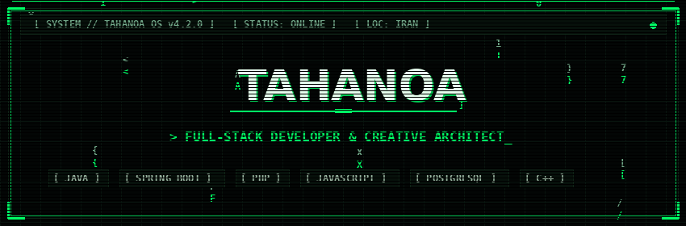
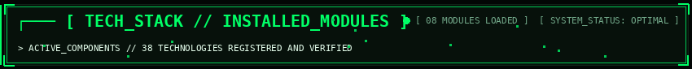
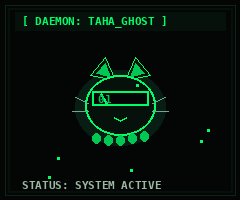

<div align="center">

<!-- HERO ANIMATED BANNER -->


<br/>

<!-- ANIMATED TERMINAL TYPING -->
<a href="https://github.com/Tahanoa">
  
</a>

<br/>


</div>

<!-- SYSTEM SPECIFICATIONS / ABOUT ME -->
### ┌─── [ SYSTEM_INFO // TAHANOA_SPEC ]

<table width="100%">
  <tr>
    <th align="left" width="28%">PARAMETER</th>
    <th align="left" width="72%">SYSTEM SPECIFICATION</th>
  </tr>
  <tr>
    <td><code>SYS_IDENTITY</code></td>
    <td><b>Taha</b> (<code>TAHANOA</code>) — Full-Stack Developer</td>
  </tr>
  <tr>
    <td><code>BACKEND_ENGINEERING</code></td>
    <td>Java & Spring Ecosystem (Spring Boot, Spring MVC, Spring Security, REST APIs, JPA)</td>
  </tr>
  <tr>
    <td><code>WEB_PLATFORMS</code></td>
    <td>Full-Stack Web Dev, Server-Rendered Apps, Custom WordPress & E-Commerce</td>
  </tr>
  <tr>
    <td><code>INFRASTRUCTURE_OPS</code></td>
    <td>Linux, Nginx, Docker, Cloudflare (Workers, D1, Reverse Proxy, SSL/TLS)</td>
  </tr>
  <tr>
    <td><code>ENGINEERING_FOCUS</code></td>
    <td>Application Architecture, API Design, Web Security, Automation & Deployment</td>
  </tr>
  <tr>
    <td><code>CURRENT_EXPLORATION</code></td>
    <td>Python <em>(Actively Learning & Automating)</em></td>
  </tr>
</table>

<div align="center">
  
</div>

<!-- TECH DASHBOARD -->
<div align="center">
  
</div>

<br/>

<table width="100%">
  <tr>
    <td width="50%" valign="top">
      <p><b><code>[ MOD_01 // BACKEND_ENGINEERING ]</code></b> &nbsp; <code>● ONLINE</code></p>
      <p>
        
        
        
        
        
        
        
        
        
      </p>
    </td>
    <td width="50%" valign="top">
      <p><b><code>[ MOD_02 // FRONTEND_ENGINEERING ]</code></b> &nbsp; <code>● ONLINE</code></p>
      <p>
        
        
        
        
        
        
        
      </p>
    </td>
  </tr>
  <tr>
    <td width="50%" valign="top">
      <p><b><code>[ MOD_03 // DATABASES_AND_DATA ]</code></b> &nbsp; <code>● ONLINE</code></p>
      <p>
        
        
        
        
        
      </p>
    </td>
    <td width="50%" valign="top">
      <p><b><code>[ MOD_04 // WORDPRESS_AND_ECOMMERCE ]</code></b> &nbsp; <code>● ONLINE</code></p>
      <p>
        
        
        
        
        
      </p>
    </td>
  </tr>
  <tr>
    <td width="50%" valign="top">
      <p><b><code>[ MOD_05 // DEVOPS_INFRASTRUCTURE_DEPLOYMENT ]</code></b> &nbsp; <code>● ONLINE</code></p>
      <p>
        
        
        
        
        
        
        
        
        
        
        
      </p>
    </td>
    <td width="50%" valign="top">
      <p><b><code>[ MOD_06 // AUTOMATION_AND_SERVERLESS ]</code></b> &nbsp; <code>● ONLINE</code></p>
      <p>
        
        
        
        
        
      </p>
    </td>
  </tr>
  <tr>
    <td width="50%" valign="top">
      <p><b><code>[ MOD_07 // CREATIVE_TOOLS_SIDE_PROJECTS ]</code></b> &nbsp; <code>● ACTIVE</code></p>
      <p>
        
        
      </p>
    </td>
    <td width="50%" valign="top">
      <p><b><code>[ MOD_08 // CURRENTLY_LEARNING ]</code></b> &nbsp; <code>⚡ SYNCING</code></p>
      <p>
        
      </p>
    </td>
  </tr>
</table>

<div align="center">
  
</div>

<!-- PROJECT SHOWCASE -->
### ┌─── [ DEPLOYED_PROJECTS // ACTIVE_NODES ]

<table>
  <tr>
    <td width="33%" align="center">
      <h3><code>sb2gh.ir</code></h3>
      <p><b>Web Application</b></p>
      <p>Active web application node built for efficient online user workflows.</p>
      <a href="https://sb2gh.ir">
        
      </a>
    </td>
    <td width="33%" align="center">
      <h3><code>noghreluna.ir</code></h3>
      <p><b>E-Commerce Platform</b></p>
      <p>Digital storefront and web platform engineered for seamless user transactions.</p>
      <a href="https://noghreluna.ir">
        
      </a>
    </td>
    <td width="33%" align="center">
      <h3><code>noghrehana.ir</code></h3>
      <p><b>Web System</b></p>
      <p>Custom online platform developed with responsive web technologies.</p>
      <a href="https://noghrehana.ir">
        
      </a>
    </td>
  </tr>
</table>

<div align="center">
  
</div>

<!-- GITHUB STATS & METRICS -->
### ┌─── [ SYSTEM_METRICS // TELEMETRY ]

<div align="center">

<p align="center">
  
  &nbsp;&nbsp;
  
</p>

#### 🐍 CONTRIBUTION MATRIX
<p align="center">
  
</p>

</div>

<div align="center">
  
</div>

<!-- SYSTEM LOG / QUOTE & DAEMON MASCOT -->
### ┌─── [ SYSTEM_LOG // PHILOSOPHY ]

<table>
  <tr>
    <td width="70%" valign="middle">
      <br/>
      <pre>
┌── [ LOG_ENTRY #001 ] ───────────────────────────────────────────┐
│                                                                  │
│  "I write code like I write poetry —                              │
│   structured, expressive, and always searching for meaning."     │
│                                                                  │
└──────────────────────────────────────────────────────────────────┘
      </pre>
      <p><i>Building software with purpose, precision, and continuous iteration.</i></p>
    </td>
    <td width="30%" align="center" valign="middle">
      
      <br/>
      <sub><code>TAHA_GHOST.daemon</code></sub>
    </td>
  </tr>
</table>

<div align="center">
  
</div>

<!-- CONTACT / COMMS -->
### ┌─── [ CONNECT // NETWORK_CHANNELS ]

<div align="center">

<p align="center">
  <a href="https://github.com/Tahanoa">
    
  </a>
  &nbsp;
  <a href="mailto:tahafarzaneh3524@gmail.com">
    
  </a>
  &nbsp;
  <a href="https://www.instagram.com/taha_ghost_/">
    
  </a>
  &nbsp;
  <a href="https://hexora.ir">
    
  </a>
</p>

<br/>

```
[ TAHANOA_OS // NETWORK_INITIALIZED // ALL_CHANNELS_ONLINE ]
```

</div>
